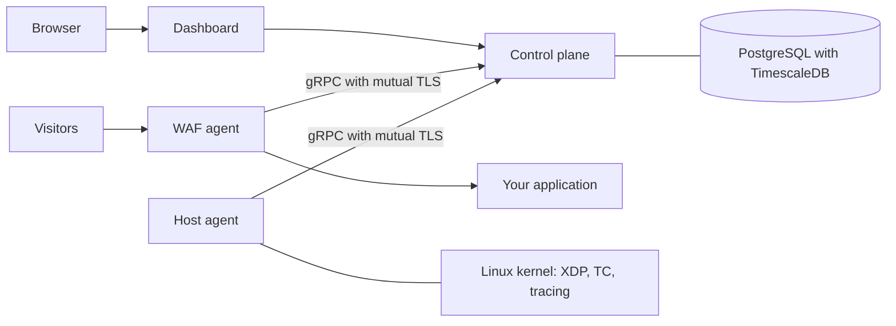

# Wafio

Wafio is a web application firewall with a host firewall and runtime security for Linux servers. You run a control
plane, and agents on the servers you protect report to it.

To install and use Wafio, start at <https://wafio.cloud/get-started>. The repositories below are for reading the code
and changing it.

## How the parts fit



The control plane stores the configuration and the events, and serves the dashboard. The WAF agent is a reverse
proxy in front of your application. The host agent filters packets and watches processes on the server itself.

## Repositories

| Repository | What it is | Language | Licence | Best practices |
|---|---|---|---|---|
| [wafio-cp-backend](https://github.com/wafio/wafio-cp-backend) | Control plane: HTTP API, agent server, database migrations, and the `shared` module both agents use | Go | GPL-3.0-only | [](https://www.bestpractices.dev/projects/16869) |
| [wafio-cp-frontend](https://github.com/wafio/wafio-cp-frontend) | Dashboard, a static app the control plane serves | SvelteKit, TypeScript | GPL-3.0-only | [](https://www.bestpractices.dev/projects/16871) |
| [wafio-agent-waf](https://github.com/wafio/wafio-agent-waf) | WAF agent: proxy, limits, bot checks, custom and script rules, the link to the control plane | Rust | GPL-3.0-only | [](https://www.bestpractices.dev/projects/16868) |
| [wafio-agent-host](https://github.com/wafio/wafio-agent-host) | Host agent: eBPF firewall and runtime security tracing | Go, BPF C | GPL-3.0-only, BPF programs GPL-2.0 | [](https://www.bestpractices.dev/projects/16870) |
| [uddin-lang-rs](https://github.com/wafio/uddin-lang-rs) | Interpreter of the uddin script language, which runs script rules inside the WAF agent | Rust | MIT | |

Two parts are not published:

- **The semantic detection engine**, which decides whether a request is an attack. The WAF agent calls it through
  one interface (`crates/engine-api`). An agent built from wafio-agent-waf alone proxies and enforces every other
  rule, and its engine finds nothing. The official `wafio-waf-agent` build includes the engine.
- **The installers and the release scripts.**

## Where a report or a change goes

| It is about | Repository |
|---|---|
| The dashboard: a page, a form, a chart | wafio-cp-frontend |
| The API, accounts and roles, stored events, agent enrollment | wafio-cp-backend |
| Proxying, routes, limits, bot checks, custom rules, the challenge page | wafio-agent-waf |
| The script language or a builtin | uddin-lang-rs |
| The firewall, blocked or allowed packets, process tracing | wafio-agent-host |
| An attack that was not detected, or a normal request that was blocked | wafio-agent-waf, as a private security report for a missed attack |
| Installing or upgrading | wafio-cp-backend, until the installers have a public place |

A security problem never goes into a public issue. Each repository has a `SECURITY.md` that says how to report it
privately.

## Working on the code

The repositories find each other as folders next to one another, so clone them into one directory:

```sh
mkdir wafio && cd wafio
git clone https://github.com/wafio/wafio-cp-backend
git clone https://github.com/wafio/wafio-cp-frontend
git clone https://github.com/wafio/wafio-agent-waf
git clone https://github.com/wafio/wafio-agent-host
git clone https://github.com/wafio/uddin-lang-rs
```

You need only the ones you work on, with these pairs:

- wafio-agent-waf builds with `../uddin-lang-rs`.
- wafio-agent-host fetches the published `shared` module of wafio-cp-backend (`shared/v0.1.0`). You need `../wafio-cp-backend` only to change `shared`.
- The dashboard's fixture check reads `../wafio-cp-backend/test/frontend-fixtures`.

Each repository has one gate, `scripts/ci-local.sh`, which runs on Linux, and a `CONTRIBUTING.md` with its rules.
The repositories under GPL-3.0 ask you to agree to a contributor licence agreement (`CLA.md`) in your first pull
request; uddin-lang-rs asks for a sign-off on each commit.
